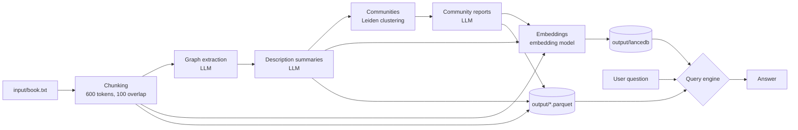

# GraphRAG Tutorial — *A Christmas Carol*

A small learning project that uses [Microsoft GraphRAG](https://github.com/microsoft/graphrag) (v3.2.0) to turn a text into a **knowledge graph** and then answer questions over it. Instead of only retrieving similar text chunks (classic RAG), GraphRAG first has an LLM extract entities, relationships and community summaries, so it can also answer "big picture" questions about the whole corpus.

Based on the Kaggle notebook [GraphRAG by william2020](https://www.kaggle.com/code/william2020/graphrag).

> **Only a small part of the book is indexed.** `input/book.txt` holds the Project Gutenberg header, the front matter and table of contents, and the beginning of *Stave One — Marley's Ghost*, ending with the nephew's "A Happy New Year!" (about 2,600 words, roughly a tenth of the novel). The ghosts, the Cratchit family's Christmas and Scrooge's change of heart are therefore not in the index. Questions about the rest of the story can only be answered from what the model already knows, not from the graph. The excerpt keeps indexing within the free models' daily request limit. To index the whole novel, replace the file with the full text from [Project Gutenberg #46](https://www.gutenberg.org/ebooks/46) and re-run `index` (expect roughly 10× as many LLM calls).

## Project layout

```
.
├── graph-rag-tutorial.ipynb   # notebook that drives init / index / query
├── settings.yaml              # GraphRAG configuration (models, chunking, storage)
├── .env                       # GRAPHRAG_API_KEY (OpenRouter key) – not committed
├── input/book.txt             # source text (opening of A Christmas Carol only, ~17 KB)
├── visualize_graph.py         # renders the graph from output/*.parquet as graph.html
├── test_llms.py               # smoke test: OpenRouter model vs. local Qwen3-4B (llama.cpp server)
├── prompts/                   # LLM prompt templates for every pipeline step
├── cache/                     # cached LLM responses (re-runs skip finished calls)
├── output/                    # the index: Parquet tables + LanceDB vector store
└── logs/                      # indexing-engine.log, query.log
```

## Models

All models are called through **OpenRouter** (via LiteLLM, `model_provider: openrouter`).

| Role | Model | Used for |
|---|---|---|
| Completion (chat) | `poolside/laguna-s-2.1:free` | graph extraction, description summaries, community reports, answering queries |
| Embedding | `liquid/lfm-2.5-embedding-350m:free` (1024-dim) | vectors for entity descriptions, community reports, text chunks, and the user's query |

> Free OpenRouter models are limited to **50 requests/day** without credits (1,000/day after adding $10 credit). Failed retries count too.

## Architecture



The system has two phases: **indexing** (expensive, run once per corpus) and **querying** (cheap, run per question).

## Phase 1 — Indexing (`python -m graphrag index --root .`)

Each step is a workflow; its result is written to `output/` and LLM responses are cached in `cache/`.

| # | Workflow | Model call? | What is sent → what comes back | Output |
|---|---|---|---|---|
| 1 | `load_input_documents` | – | reads `input/*.txt` | `documents.parquet` |
| 2 | `create_base_text_units` | – | splits text into token chunks (`o200k_base`) | `text_units.parquet` (9 chunks) |
| 3 | `extract_graph` | **Chat** | **Sent:** one chunk + `prompts/extract_graph.txt` (entity types: person, organization, geo, event).<br>**Returned:** a delimited list of `("entity"<\|>NAME<\|>TYPE<\|>description)` and `("relationship"<\|>SOURCE<\|>TARGET<\|>description<\|>strength)` records, ending with `<\|COMPLETE\|>`. With `max_gleanings: 1` the model is asked once more whether it missed anything. | raw entities/relationships |
| 4 | *(summarize descriptions)* | **Chat** | **Sent:** all descriptions of the same entity/relationship found across chunks.<br>**Returned:** one merged description (≤ 500 tokens). | `entities.parquet`, `relationships.parquet` |
| 5 | `finalize_graph` | – | computes node degree etc. | |
| 6 | `extract_covariates` | – | claim extraction is **disabled** in `settings.yaml` | |
| 7 | `create_communities` | – | Leiden clustering into a hierarchy of communities (max size 10) | `communities.parquet` |
| 8 | `create_final_text_units` | – | links chunks to the entities they mention | `text_units.parquet` |
| 9 | `create_community_reports` | **Chat** | **Sent:** the entities + relationships of one community + `prompts/community_report_graph.txt`.<br>**Returned:** JSON `{title, summary, rating (0–10), rating_explanation, findings: [{summary, explanation}]}`. | `community_reports.parquet` |
| 10 | `generate_text_embeddings` | **Embedding** | **Sent:** entity descriptions, full community reports, chunk texts.<br>**Returned:** 1024-dim vectors. Texts longer than `batch_max_tokens: 400` are split and averaged, because the embedding model rejects inputs over 512 tokens. | `output/lancedb/` |

### Current index (last run, 2026-10-03)

- Built from the **opening excerpt only** (see note at the top), not the whole book
- 9 text chunks → **73 entities**, **32 relationships** (most connected: Scrooge, Nephew, Christmas, Spirits, Bob Cratchit); about 43 entities have no relationships
- **6 communities** on 2 levels, **6 community reports**
- Embeddings: **complete** (entity descriptions, community reports, text chunks), so all four query methods work

## Phase 2 — Querying (`python -m graphrag query "<question>" --method <m> --root .`)

| Method | Best for | Data used | Model calls → responses |
|---|---|---|---|
| `global` | whole-corpus questions ("What are the main themes?") | community reports | **Map:** each batch of reports + question → JSON `{"points": [{"description", "score" 0–100}]}`.<br>**Reduce:** top-scored points → final answer in Markdown with `[Data: Reports (…)]` citations. |
| `local` | questions about specific entities ("Who is Bob Cratchit?") | entities, relationships, chunks, reports + embeddings | **Embed** the question → find nearest entities → gather their neighbours, chunks and reports into a context window → **chat** returns the answer with `[Data: Entities/Relationships/Sources (…)]` citations. |
| `drift` | mix of local detail and global context | everything | Starts like `local`, generates follow-up questions, answers them locally, then **reduces** everything into one answer. Most LLM calls. |
| `basic` | baseline comparison | chunks + embeddings | Classic vector RAG: embed question → top chunks → one chat call. |

Examples:

```bash
python -m graphrag query "What are the main themes of this story?" --method global --root .
python -m graphrag query "Who is Bob Cratchit and how is he related to Scrooge?" --method local --root .
```

`global` works as soon as community reports exist. `local`, `drift` and `basic` also need the embeddings from step 10.

## Setup

```bash
python -m venv .venv && source .venv/bin/activate
pip install graphrag
python -m graphrag init --root . --model <chat-model> --embedding <embedding-model>
# put GRAPHRAG_API_KEY=sk-or-... into .env, set model_provider: openrouter in settings.yaml
python -m graphrag index --root .
```

## Known issues / notes

- Use `python -m graphrag …` instead of the `graphrag` launcher: the `.venv` was copied from another folder, so `.venv/bin/graphrag` points to a Python that no longer exists.
- Free models sometimes drop large requests (`Server disconnected`) or hit the daily limit (`429 free-models-per-day`). Check `logs/indexing-engine.log`. Re-running `index` reuses `cache/` and only performs the missing calls.
- If you see `Embedding input has N tokens, exceeding the model maximum of 512`, lower `embed_text.batch_max_tokens` in `settings.yaml`.
- The notebook's `init` cell uses `--force`, which overwrites `settings.yaml` and `prompts/`. Don't re-run it on a configured project.
- Small free models can copy names from the prompt's few-shot examples into the graph (e.g. *ALCHEMISTS GUILD*). A stronger chat model gives a cleaner graph.
